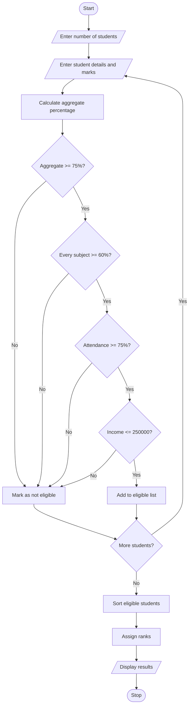

# 1. Problem Statement
The University Scholarship Allocation System is designed to evaluate scholarship applications based on academic performance, subject-wise minimum marks, attendance percentage, and family income.

The system checks whether each student satisfies all the eligibility criteria. Eligible students are ranked according to their aggregate marks. If two or more students have the same aggregate marks, predefined tie-breaking rules are used.

Objectives:
1. Accept student details, including marks, attendance, and family income.
2. Check the minimum marks required in each subject.
3. Verify aggregate marks, attendance, and income eligibility.
4. Rank eligible students in descending order of aggregate marks.
5. Resolve ties using subject marks, attendance, and student ID.
6. Display eligible students, their ranks, and rejected applicants with reasons.
Eligibility Criteria Used in This Example
The following values are sample rules for this program, not official university scholarship requirements.
Criterion	Requirement
Aggregate marks	At least 75%
Minimum marks in each subject	At least 60%
Attendance	At least 75%
Annual family income	Not more than ₹2,50,000

Tie-breaking rules:
1. Higher aggregate percentage ranks first.
2. If aggregate percentages are equal, higher Mathematics marks rank first.
3. If Mathematics marks are also equal, higher attendance ranks first.
4. If all the above are equal, the lower student ID ranks first.
# 2. Algorithm
Step 1: Start the program.

Step 2: Read the number of student applications.

Step 3: For each student, input:
- Student ID and name
- Marks in Mathematics, Physics, and Chemistry
- Attendance percentage
- Annual family income
Step 4: Calculate the aggregate percentage.
\[
\text{Aggregate Percentage} =
\frac{\text{Maths}+\text{Physics}+\text{Chemistry}}{3}
\]
Step 5: Check all eligibility conditions:
- Aggregate percentage ≥ 75%.
- Each subject mark ≥ 60%.
- Attendance ≥ 75%.
- Annual family income ≤ ₹2,50,000.
Step 6: If all conditions are satisfied, mark the student as eligible. Otherwise, record the reason for rejection.

Step 7: Sort eligible students according to the tie-breaking rules.

Step 8: Assign ranks to eligible students.

Step 9: Display the eligible students, their aggregate percentages, ranks, and rejected students with reasons.

Step 10: Stop the program.
# 3. Flowchart (Mermaid)

# 4. Source Code (Python)
MIN_AGGREGATE = 75
MIN_SUBJECT_MARK = 60
MIN_ATTENDANCE = 75
MAX_INCOME = 250000

def evaluate_student(student):
    marks = [
        student["maths"],
        student["physics"],
        student["chemistry"]
    ]

    aggregate = sum(marks) / 3
    student["aggregate"] = aggregate

    reasons = []

    if aggregate < MIN_AGGREGATE:
        reasons.append("Aggregate below 75%")

    if any(mark < MIN_SUBJECT_MARK for mark in marks):
        reasons.append("Subject mark below 60%")

    if student["attendance"] < MIN_ATTENDANCE:
        reasons.append("Attendance below 75%")

    if student["income"] > MAX_INCOME:
        reasons.append("Income exceeds Rs. 250000")

    student["reasons"] = reasons
    student["eligible"] = len(reasons) == 0

def main():
    students = []

    n = int(input("Enter number of students: "))

    for i in range(n):
        print("\nEnter student details")

        sid = int(input("Student ID: "))
        name = input("Name: ")
        maths = float(input("Mathematics marks: "))
        physics = float(input("Physics marks: "))
        chemistry = float(input("Chemistry marks: "))
        attendance = float(input("Attendance percentage: "))
        income = float(input("Annual family income: "))

        student = {
            "id": sid,
            "name": name,
            "maths": maths,
            "physics": physics,
            "chemistry": chemistry,
            "attendance": attendance,
            "income": income
        }

        evaluate_student(student)
        students.append(student)

    eligible = [s for s in students if s["eligible"]]
    rejected = [s for s in students if not s["eligible"]]

    # Ranking and tie-breaking rules
    eligible.sort(
        key=lambda s: (
            -s["aggregate"],
            -s["maths"],
            -s["attendance"],
            s["id"]
        )
    )

    print("\n===== SCHOLARSHIP RANK LIST =====")

    if eligible:
        print(f"{'Rank':<6}{'ID':<8}{'Name':<15}{'Aggregate %':>12}")

        for rank, s in enumerate(eligible, start=1):
            print(
                f"{rank:<6}{s['id']:<8}{s['name']:<15}"
                f"{s['aggregate']:>12.2f}"
            )
    else:
        print("No eligible students.")

    print("\n===== NOT ELIGIBLE =====")

    if rejected:
        for s in rejected:
            print(
                f"{s['name']} (ID {s['id']}): "
                + "; ".join(s["reasons"])
            )
    else:
        print("No rejected applicants.")

if __name__ == "__main__":
    main()
 # 5. Sample Input
 Enter number of students: 4

Enter student details
Student ID: 103
Name: Anu
Mathematics marks: 90
Physics marks: 85
Chemistry marks: 95
Attendance percentage: 92
Annual family income: 180000

Enter student details
Student ID: 101
Name: Ravi
Mathematics marks: 90
Physics marks: 90
Chemistry marks: 90
Attendance percentage: 95
Annual family income: 200000

Enter student details
Student ID: 102
Name: Sita
Mathematics marks: 70
Physics marks: 80
Chemistry marks: 75
Attendance percentage: 88
Annual family income: 150000

Enter student details
Student ID: 104
Name: Kiran
Mathematics marks: 80
Physics marks: 78
Chemistry marks: 82
Attendance percentage: 80
Annual family income: 300000
# 6. Sample Output
===== SCHOLARSHIP RANK LIST =====
Rank  ID      Name          Aggregate %
1     101     Ravi                90.00
2     103     Anu                 90.00

===== NOT ELIGIBLE =====
Sita (ID 102): Aggregate below 75%
Kiran (ID 104): Income exceeds Rs. 250000
# 7. Screenshot of the Output

