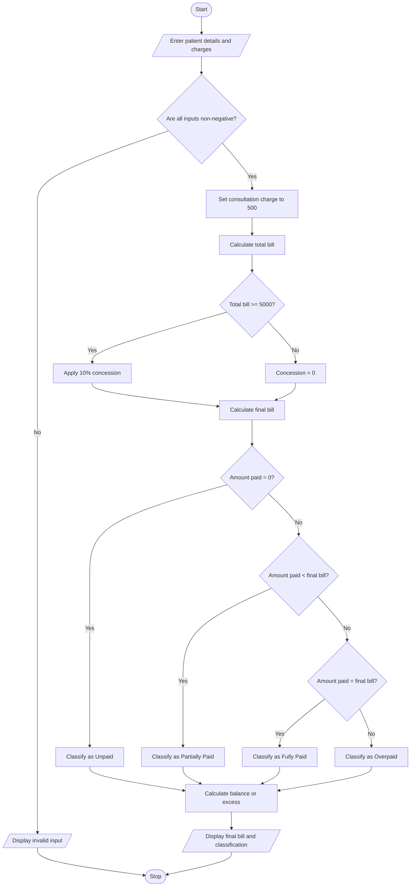

# 1. Problem Statement
The Hospital Billing and Patient Classification System is designed to calculate a patient's total hospital bill by considering consultation charges, diagnostic charges, and treatment charges.

The system applies concessions based on predefined conditions, validates billing constraints, calculates the final amount payable, and classifies patients according to a payment policy.
Objectives
1. Accept patient details and hospital service charges.
2. Calculate the total bill, including consultation, diagnostic, and treatment charges.
3. Apply concessions according to predefined eligibility conditions.
4. Validate the charges and ensure that the bill does not contain negative amounts.
5. Calculate the final amount payable after concessions.
6. Classify patients according to their payment status.
7. Display the billing details and patient classification.
Sample Billing Policy
The following rules are examples for this program, not an actual hospital's billing policy.
Condition	Policy
Consultation charges	₹500
Diagnostic charges	Entered by the user
Treatment charges	Entered by the user
Concession	10% if the total bill is ₹5,000 or more
Payment status	Entered by the user
Fully paid	Amount paid equals the final bill
Partially paid	Amount paid is greater than zero but less than the final bill
Unpaid	Amount paid is zero
Overpaid	Amount paid exceeds the final bill

Billing formula:

Total bill:
\[
\text{Total Bill}=\text{Consultation}+\text{Diagnostics}+\text{Treatment}
\]
Concession:
\[
\text{Concession}=
\begin{cases}
10\% \text{ of Total Bill}, & \text{if Total Bill} \geq ₹5000\\
0, & \text{otherwise}
\end{cases}
\]
Final bill:
\[
\text{Final Bill}=\text{Total Bill}-\text{Concession}
\]
Balance:
\[
\text{Balance}=\text{Final Bill}-\text{Amount Paid}
\]
# 2. Algorithm
Step 1: Start the program.

Step 2: Enter the patient ID, patient name, diagnostic charges, treatment charges, and amount paid.

Step 3: Set consultation charges to ₹500.

Step 4: Validate the input values. Charges and amount paid must not be negative.

Step 5: Calculate the total bill by adding consultation, diagnostic, and treatment charges.

Step 6: Check whether the total bill is ₹5,000 or more.
- If yes, apply a 10% concession.
- Otherwise, the concession is zero.
Step 7: Calculate the final bill after deducting the concession.

Step 8: Compare the amount paid with the final bill.
- If the amount paid is zero, classify the patient as Unpaid.
- If the amount paid is greater than zero but less than the final bill, classify the patient as Partially Paid.
- If the amount paid equals the final bill, classify the patient as Fully Paid.
- If the amount paid exceeds the final bill, classify the patient as Overpaid.
Step 9: Calculate the remaining balance or excess payment.

Step 10: Display the complete bill and patient classification.

Step 11: Stop the program.
# 3. Flowchart (Mermaid)

# 4. Source Code (Python)
CONSULTATION_CHARGE = 500
CONCESSION_LIMIT = 5000
CONCESSION_RATE = 0.10

patient_id = input("Enter patient ID: ")
name = input("Enter patient name: ")

diagnostic = float(input("Enter diagnostic charges: "))
treatment = float(input("Enter treatment charges: "))
paid = float(input("Enter amount paid: "))

# Validate input
if diagnostic < 0 or treatment < 0 or paid < 0:
    print("Invalid input: Amounts cannot be negative.")

else:
    total = CONSULTATION_CHARGE + diagnostic + treatment

    # Apply concession
    if total >= CONCESSION_LIMIT:
        concession = total * CONCESSION_RATE
    else:
        concession = 0

    final_bill = total - concession
    balance = final_bill - paid

    # Classify patient
    if paid == 0:
        status = "Unpaid"
    elif paid < final_bill:
        status = "Partially Paid"
    elif paid == final_bill:
        status = "Fully Paid"
    else:
        status = "Overpaid"

    # Display bill
    print("\n===== HOSPITAL BILL =====")
    print("Patient ID:", patient_id)
    print("Patient Name:", name)
    print("Consultation:", CONSULTATION_CHARGE)
    print("Diagnostics:", diagnostic)
    print("Treatment:", treatment)
    print("Total Bill:", total)
    print("Concession:", concession)
    print("Final Bill:", final_bill)
    print("Amount Paid:", paid)

    if balance > 0:
        print("Balance Due:", balance)
    elif balance < 0:
        print("Excess Payment:", -balance)
    else:
        print("Balance Due: 0.00")

    print("Patient Classification:", status)
    # 5. Sample Input
    Enter patient ID: P1001
Enter patient name: Ravi
Enter diagnostic charges: 2500
Enter treatment charges: 3000
Enter amount paid: 3000
# 6. Sample Output
===== HOSPITAL BILL =====
Patient ID          : P1001
Patient Name        : Ravi
Consultation Charges: Rs. 500.00
Diagnostic Charges  : Rs. 2500.00
Treatment Charges   : Rs. 3000.00
Total Bill          : Rs. 6000.00
Concession          : Rs. 600.00
Final Bill          : Rs. 5400.00
Amount Paid         : Rs. 3000.00
Balance Due         : Rs. 2400.00
Patient Classification: Partially Paid
# 7. Screenshot of the Output

  
     
