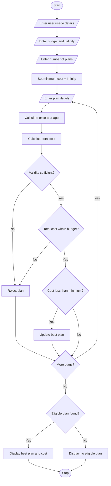

# 1. Problem Statement
The Multi-Plan Telecommunications Cost Optimization system is designed to compare different mobile recharge plans based on the user's requirements.

The system takes data usage, call minutes, SMS usage, required validity days, and budget as input. It evaluates multiple mobile plans, calculates additional charges for excess usage, checks validity and budget constraints, and identifies the most economical eligible mobile plan.
# 2. Algorithm
1. Start.
2. Enter the user's data usage in GB.
3. Enter call minutes and SMS usage.
4. Enter required validity days.
5. Enter the user's budget.
6. Enter the number of mobile plans.
7. Read the details of each plan:
   - Plan name
   - Base cost
   - Data limit
   - Call limit
   - SMS limit
   - Validity days
   - Extra data, call and SMS charges.
8. Calculate excess data, calls and SMS.
9. Calculate the total cost.
10. Check whether the plan satisfies validity and budget constraints.
11. Select the eligible plan with the lowest total cost.
12. Display the most economical plan and its total cost.
13. Stop.
# 3. Flowchart (Mermaid)

# 4. Python Source Code
usage_data = float(input("Enter data usage (GB): "))
usage_calls = int(input("Enter call minutes: "))
usage_sms = int(input("Enter SMS usage: "))

required_validity = int(input("Enter required validity days: "))
budget = float(input("Enter your budget: "))

n = int(input("Enter number of mobile plans: "))

best_cost = float('inf')
best_plan = ""

for i in range(n):

    print("\nEnter Plan", i + 1)

    name = input("Plan name: ")

    price = float(input("Base price: "))
    data = float(input("Data limit (GB): "))
    calls = int(input("Call limit: "))
    sms = int(input("SMS limit: "))
    validity = int(input("Validity days: "))

    extra_data = float(input("Extra data charge per GB: "))
    extra_calls = float(input("Extra call charge per minute: "))
    extra_sms = float(input("Extra SMS charge: "))

    # Calculate excess usage
    excess_data = max(0, usage_data - data)
    excess_calls = max(0, usage_calls - calls)
    excess_sms = max(0, usage_sms - sms)

    # Calculate total cost
    total_cost = (price +
                  excess_data * extra_data +
                  excess_calls * extra_calls +
                  excess_sms * extra_sms)

    print("\nPlan:", name)
    print("Total Cost: Rs.", round(total_cost, 2))

    # Check eligibility
    if validity >= required_validity and total_cost <= budget:

        print("Status: Eligible")

        if total_cost < best_cost:
            best_cost = total_cost
            best_plan = name

    else:
        print("Status: Not Eligible")

# Display result
print("\n------ FINAL RESULT ------")

if best_plan != "":
    print("Best Plan:", best_plan)
    print("Minimum Cost: Rs.", round(best_cost, 2))

else:
    print("No eligible mobile plan found")
# 5. Sample Input   
| Details | Plan 1 | Plan 2 | Plan 3 | Plan 4 |
|---|---:|---:|---:|---:|
| Name | Basic | Smart | Mini | Super |
| Base price | 199 | 249 | 179 | 299 |
| Data limit | 5 GB | 10 GB | 4 GB | 15 GB |
| Call limit | 300 | 500 | 400 | 600 |
| SMS limit | 100 | 100 | 50 | 100 |
| Validity | 28 | 28 | 21 | 56 |
| Extra data/GB | 20 | 20 | 20 | 20 |
| Extra call/min | 0.50 | 0.50 | 0.50 | 0.50 |
| Extra SMS | 0.10 | 0.10 | 0.10 | 0.10 |
# 6. Sample Output
Enter data usage (GB): 8
Enter call minutes: 450
Enter SMS usage: 80

Enter required validity days: 28
Enter your budget: 300
Enter number of mobile plans: 4

Plan: Basic
Total Cost: Rs. 334.0
Status: Not Eligible

Plan: Smart
Total Cost: Rs. 249.0
Status: Eligible

Plan: Mini
Total Cost: Rs. 287.0
Status: Not Eligible

Plan: Super
Total Cost: Rs. 299.0
Status: Eligible

------ FINAL RESULT ------

Best Plan: Smart
Minimum Cost: Rs. 249.0
# 7. Screenshot of Output

