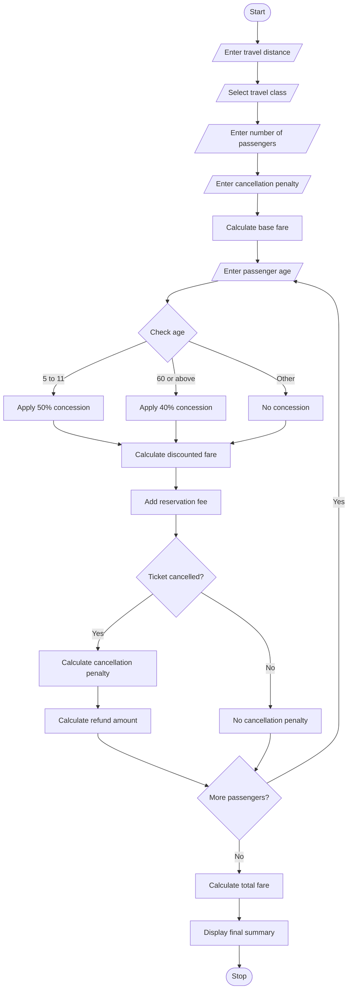

# 1. Problem Statement
The Railway Fare and Reservation Calculator is a Python-based system designed to calculate railway ticket fares for multiple passengers.

The system calculates ticket fares based on travel distance, travel class, passenger age, age-based concessions, and reservation fees. It also calculates cancellation penalties and refund amounts for cancelled tickets.

The main objective is to calculate the total railway fare accurately and provide the final reservation and cancellation details for all passengers.
# 2. Algorithm
1. Start the program.
2. Enter the travel distance in kilometres.
3. Select the travel class (Sleeper, 3AC, 2AC, or 1AC).
4. Enter the number of passengers.
5. Enter the cancellation penalty percentage.
6. Set the fare rate according to the selected class.
7. Calculate the base fare using distance × class rate.
8. For each passenger:
   - Enter the passenger's age.
   - Check age-based concessions.
   - Calculate the discounted fare.
   - Add the reservation fee.
   - Ask whether the ticket is cancelled.
9. If the ticket is cancelled:
   - Calculate the cancellation penalty.
   - Calculate the refund amount.
10. Calculate the total booking fare.
11. Display passenger-wise fare details.
12. Display the total fare, cancellation penalty and refund amount.
13. Stop.
# 3. Flowchart (Mermaid)

# 4. Python Source Code
distance = float(input("Enter travel distance (km): "))

print("\nTravel Classes")
print("1. Sleeper")
print("2. 3AC")
print("3. 2AC")
print("4. 1AC")

travel_class = input("Enter travel class: ").upper()

# Fare rates per kilometre
if travel_class == "SLEEPER":
    rate = 1.5
elif travel_class == "3AC":
    rate = 2.5
elif travel_class == "2AC":
    rate = 3.5
elif travel_class == "1AC":
    rate = 5.0
else:
    print("Invalid class")
    exit()

n = int(input("Enter number of passengers: "))

penalty_percent = float(
    input("Enter cancellation penalty percentage: ")
)

reservation_fee = 20

total_fare = 0
total_penalty = 0
total_refund = 0

for i in range(n):

    print("\nPassenger", i + 1)

    age = int(input("Enter age: "))

    base_fare = distance * rate

    # Age concession
    if 5 <= age <= 11:
        discount = 50
    elif age >= 60:
        discount = 40
    else:
        discount = 0

    discounted_fare = base_fare - (
        base_fare * discount / 100
    )

    fare = discounted_fare + reservation_fee

    print("Base fare: Rs.", round(base_fare, 2))
    print("Age concession:", discount, "%")
    print("Reservation fee: Rs.", reservation_fee)
    print("Total fare: Rs.", round(fare, 2))

    cancelled = input("Cancelled? (yes/no): ").lower()

    if cancelled == "yes":

        penalty = discounted_fare * penalty_percent / 100

        refund = fare - penalty

        total_penalty += penalty
        total_refund += refund

        print("Cancellation penalty: Rs.", round(penalty, 2))
        print("Refund amount: Rs.", round(refund, 2))

    else:

        penalty = 0
        refund = 0

        print("Ticket confirmed")

    total_fare += fare

# Final result
print("\n===== FINAL SUMMARY =====")

print("Total booking fare: Rs.", round(total_fare, 2))

print("Total cancellation penalty: Rs.",
      round(total_penalty, 2))

print("Total refund for cancelled tickets: Rs.",
      round(total_refund, 2))
  # 6. Sample Input
  Enter travel distance (km): 500

Travel Classes
1. Sleeper
2. 3AC
3. 2AC
4. 1AC

Enter travel class: 3AC

Enter number of passengers: 3

Enter cancellation penalty percentage: 25

Passenger 1
Enter age: 25
Cancelled? (yes/no): no

Passenger 2
Enter age: 65
Cancelled? (yes/no): yes

Passenger 3
Enter age: 10
Cancelled? (yes/no): no
# 7. Sample Output
Passenger 1

Base fare: Rs. 1250.0
Age concession: 0 %
Reservation fee: Rs. 20
Total fare: Rs. 1270.0

Ticket confirmed

Passenger 2

Base fare: Rs. 1250.0
Age concession: 40 %
Reservation fee: Rs. 20
Total fare: Rs. 770.0

Cancellation penalty: Rs. 187.5
Refund amount: Rs. 582.5

Passenger 3

Base fare: Rs. 1250.0
Age concession: 50 %
Reservation fee: Rs. 20
Total fare: Rs. 645.0

Ticket confirmed

===== FINAL SUMMARY =====

Total booking fare: Rs. 2685.0

Total cancellation penalty: Rs. 187.5

Total refund for cancelled tickets: Rs. 582.5
# 7. Screenshot of Output

