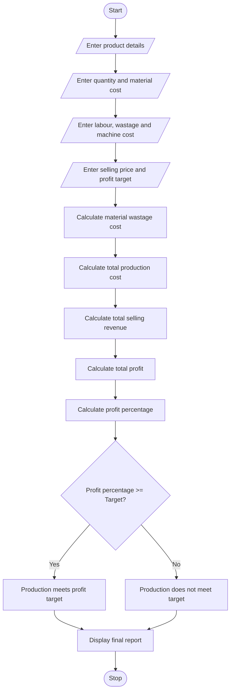

# 1. Problem Statement
The Manufacturing Cost and Profitability Analysis system is designed to calculate the total production cost and profit of manufactured products.

The system considers material costs, labour charges, material wastage, machine costs, and selling prices. It calculates the total manufacturing cost, profit per product, and profit percentage.

Finally, the system compares the actual profit percentage with the specified profit target and identifies whether the production meets the expected profitability target.
# 2. Algorithm
1. Start.
2. Enter the product name.
3. Enter the number of products manufactured.
4. Enter the material cost per product.
5. Enter the labour charges per product.
6. Enter the wastage percentage.
7. Enter the machine cost per product.
8. Enter the selling price per product.
9. Enter the expected profit target percentage.
10. Calculate material wastage cost.
11. Calculate total manufacturing cost.
12. Calculate total production cost.
13. Calculate total selling revenue.
14. Calculate total profit.
15. Calculate profit percentage.
16. Compare the actual profit percentage with the target.
17. Display the total cost, revenue, profit and profitability status.
18. Stop.
# 3. Flowchart (Mermaid)

# 4. Python Source Code
print("MANUFACTURING COST AND PROFITABILITY ANALYSIS")

product = input("Enter product name: ")

quantity = int(input("Enter number of products: "))

material = float(input("Enter material cost per product: "))

labour = float(input("Enter labour charges per product: "))

wastage = float(input("Enter wastage percentage: "))

machine = float(input("Enter machine cost per product: "))

selling = float(input("Enter selling price per product: "))

target = float(input("Enter profit target percentage: "))

# Calculate wastage cost
wastage_cost = material * wastage / 100

# Calculate production cost per product
cost = material + wastage_cost + labour + machine

# Calculate total production cost
total_cost = cost * quantity

# Calculate total revenue
revenue = selling * quantity

# Calculate profit
profit = revenue - total_cost

# Calculate profit percentage
profit_percent = (profit / total_cost) * 100

# Display results
print("\n===== FINAL REPORT =====")

print("Product Name:", product)

print("Quantity:", quantity)

print("Material Cost:", material * quantity)

print("Wastage Cost:", wastage_cost * quantity)

print("Labour Cost:", labour * quantity)

print("Machine Cost:", machine * quantity)

print("Total Production Cost:", total_cost)

print("Total Selling Revenue:", revenue)

print("Total Profit:", profit)

print("Profit Percentage:", round(profit_percent, 2), "%")

# Check profit target
if profit_percent >= target:
    print("Status: Profit Target Achieved")
else:
    print("Status: Profit Target Not Achieved")
  # 5. Sample Input
  Enter product name: Chairs
Enter number of products: 100
Enter material cost per product: 200
Enter labour charges per product: 50
Enter wastage percentage: 10
Enter machine cost per product: 30
Enter selling price per product: 350
Enter profit target percentage: 15
# 6. Sample Output
MANUFACTURING COST AND PROFITABILITY ANALYSIS

===== FINAL REPORT =====

Product Name: Chairs

Quantity: 100

Material Cost: 20000.0

Wastage Cost: 2000.0

Labour Cost: 5000.0

Machine Cost: 3000.0

Total Production Cost: 30000.0

Total Selling Revenue: 35000.0

Total Profit: 5000.0

Profit Percentage: 16.67 %

Status: Profit Target Achieved
# 7. Screenshot of Output

