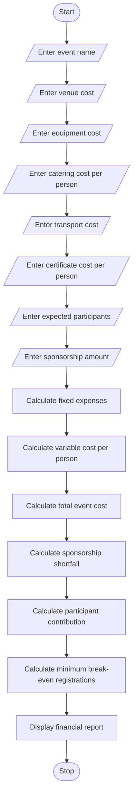

# 1. Problem Statement
The Campus Event Financial Planning system is designed to calculate and manage the total expenses required to organize a college event.

The system considers different expenses such as venue charges, equipment costs, catering costs, transportation costs, and certificate costs. It calculates the total event budget, sponsorship amount, sponsorship shortfall, and participant contribution.

It also determines the minimum number of participants required to register to break even. The main objective is to help colleges organize events within their available budget and avoid financial losses.
# 2. Algorithm
1. Start.
2. Enter the event name.
3. Enter venue cost.
4. Enter equipment cost.
5. Enter catering cost per participant.
6. Enter transportation cost.
7. Enter certificate cost per participant.
8. Enter the expected number of participants.
9. Enter the sponsorship amount.
10. Calculate total fixed expenses.
11. Calculate variable cost per participant.
12. Calculate the total event cost.
13. Calculate sponsorship shortfall, if any.
14. Calculate the remaining amount after sponsorship.
15. Calculate participant contribution per person.
16. Calculate the minimum registration count required to break even.
17. Display the complete financial report.
18. Stop.
# 3. Flowchart (Mermaid)

# 4. Python Source Code
print("CAMPUS EVENT FINANCIAL PLANNING")

event = input("Enter event name: ")

# Fixed expenses
venue = float(input("Enter venue cost: "))
equipment = float(input("Enter equipment cost: "))
transport = float(input("Enter transport cost: "))

# Variable expenses
catering = float(input("Enter catering cost per person: "))
certificate = float(input("Enter certificate cost per person: "))

participants = int(input("Enter expected participants: "))

sponsorship = float(input("Enter sponsorship amount: "))

# Calculate fixed cost
fixed_cost = venue + equipment + transport

# Calculate variable cost
variable_cost = catering + certificate

# Calculate total event cost
total_cost = fixed_cost + (variable_cost * participants)

# Calculate sponsorship shortfall
shortfall = max(0, fixed_cost - sponsorship)

# Calculate remaining amount
remaining = max(0, total_cost - sponsorship)

# Participant contribution per person
contribution = remaining / participants

# Calculate break-even registration count
if contribution > variable_cost:
    break_even = int(fixed_cost / (contribution - variable_cost)) + 1
else:
    break_even = 0

# Display report
print("\n===== EVENT FINANCIAL REPORT =====")

print("Event Name:", event)

print("Fixed Expenses: Rs.", fixed_cost)

print("Variable Cost Per Person: Rs.", variable_cost)

print("Total Event Cost: Rs.", total_cost)

print("Sponsorship Amount: Rs.", sponsorship)

print("Sponsorship Shortfall: Rs.", shortfall)

print("Participant Contribution: Rs.", round(contribution, 2))

if break_even > 0:
    print("Minimum Break-Even Registrations:", break_even)
else:
    print("Break-even cannot be achieved with this contribution.")

print("\nEvent Financial Planning Completed")
# 5. Sample Input
| Input | Amount |
|---|---:|
| Event Name | Tech Fest |
| Venue Cost | Rs. 10,000 |
| Equipment Cost | Rs. 5,000 |
| Transport Cost | Rs. 3,000 |
| Catering per person | Rs. 150 |
| Certificate per person | Rs. 50 |
| Expected Participants | 100 |
| Sponsorship Amount | Rs. 12,000 |
Enter event name: Tech Fest

Enter venue cost: 10000
Enter equipment cost: 5000
Enter transport cost: 3000

Enter catering cost per person: 150
Enter certificate cost per person: 50

Enter expected participants: 100

Enter sponsorship amount: 12000
# 6. Sample Output
CAMPUS EVENT FINANCIAL PLANNING

===== EVENT FINANCIAL REPORT =====

Event Name: Tech Fest

Fixed Expenses: Rs. 18000.0

Variable Cost Per Person: Rs. 200.0

Total Event Cost: Rs. 38000.0

Sponsorship Amount: Rs. 12000.0

Sponsorship Shortfall: Rs. 6000.0

Participant Contribution: Rs. 260.0

Minimum Break-Even Registrations: 300

Event Financial Planning Completed
# 7. Screenshot of Output

